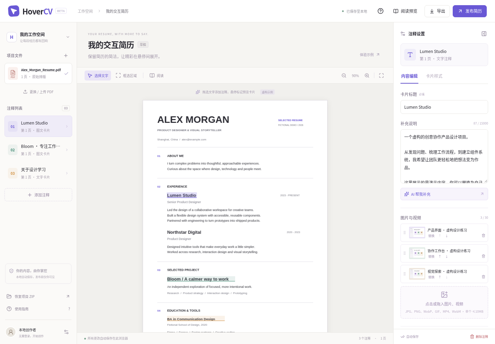

# HoverCV

**让简历，多一点故事。** 上传 PDF，选词或框选区域，为经历添加可悬停的图文、视频和链接卡片。中文编辑器，保留 PDF 原排版。



本项目依据用户提供的开发提示词从零构建。 后续补充的 [原始 PRD](docs/PRD.md) 已归档，[实现差异](docs/PRD_REVIEW.md) 和 [正式验收映射](docs/ACCEPTANCE.md) 如实记录部分实现及未验证内容。界面参考 [awesome-design-md](https://github.com/VoltAgent/awesome-design-md) 的 Notion 与 Linear 分析，设计规则见 [DESIGN.md](DESIGN.md)。示例简历与作品均为虚构。

## 最快开始：本地编辑与导出

第一次在电脑使用，请先看 [本机测试指引](START_HERE_ZH.md)：[下载源码 ZIP](https://github.com/Roy-Loong/HoverCV-resume/archive/refs/heads/main.zip)，解压后双击对应的 Windows/Mac 启动文件即可。已安装 Node.js v24 时无需重新安装。

需要 Node.js 24 和 npm（Node.js 的依赖安装工具）。

```bash
npm ci
npm run dev
```

在运行机器的浏览器访问应用的 3000 端口。首次打开会载入**虚构示例**。点击左侧“更换 / 上传 PDF”，导入真实 PDF。无需账户或密钥即可编辑和导出。

- **选词**：拖选一行或多行文字，自动建立逐行标记。同名词单独选取，坐标不做字符串猜测。
- **框选**：切换“框选区域”，拖出矩形；适合图片、照片、LOGO 和扫描版。不会自动 OCR（识别扫描文字）。
- **编辑**：右侧修改标题与说明，拖入、排序、替换素材，添加链接。“卡片样式”切换三模板、四色、自选颜色、提取主色或重新定位。
- **悬停**：180 ms 打开；通过卡片安全通道保持显示，离开后 250 ms 关闭。手机点击后显示底部浮层。视频由读者手动播放。
- **保存**：本地自动存入 IndexedDB（浏览器内的项目数据库）。清除浏览器数据会删除本地项目，请定期导出项目 ZIP。
- **导出**：独立 HTML、离线阅读 ZIP、可编辑项目 ZIP。前两种可阅读，最后一种可导入继续编辑。超过 25 MB 的单文件会要求改用 ZIP，视频不会被省略。原 PDF 不包含网页悬停功能。

## 本地作者账户、云草稿与分享

除了 Node.js，需要 Docker。以下命令生成本地专用密钥，启动仅监听回环地址的开发数据库，并执行迁移：

```bash
npm run local:setup
npm run dev
```

开发配置保存在被 Git 忽略的 `.env.local`，使用 PostgreSQL 与 `.data/private` 私有文件目录。开发数据库使用本机 trust 认证，仅限隔离的开发环境；正式部署用下面的密码配置。数据库迁移可以重复执行。

点击“发布简历”→注册作者账户（密码至少 12 位）→“保存草稿并发布新版本”。生成的 `/read/<编号>` 是 HR 阅读页，无需登录；仅作者能访问草稿。项目设置可单独保存/恢复云草稿。每次发布都是不可变快照，修改草稿后需重新发布；旧版本可在发布窗口中撤回。

`revision` 是草稿版本号。若两个窗口同时保存，旧版本收到 409 冲突提示，请先备份本地项目，再恢复最新云草稿，不会静默覆盖。

## 可选 AI 与配图

在 `.env.local` 或部署的环境变量中设置，重启应用：

| 变量                  | 用途                                                             |
| --------------------- | ---------------------------------------------------------------- |
| `AI_API_BASE`         | OpenAI 兼容接口的 HTTPS 基地址，默认 `https://api.openai.com/v1` |
| `AI_API_KEY`          | 模型服务密钥，仅放后端                                           |
| `AI_MODEL`            | 模型名称，示例 `gpt-4.1-mini`                                    |
| `TAVILY_API_KEY`      | Tavily 真实搜索密钥                                              |
| `IMAGE_ALLOWED_HOSTS` | 允许导入图片的站点，默认 Unsplash/Pexels 图片主机                |

AI 需作者登录。先预览和确认关键词及最多 500 字上下文，再联网检索与生成结构化草稿。不会发送整份 PDF；引用必须属于本次检索结果。用户确认后才写入。搜索配图逐个手动选择导入；其他站点图片请下载后手动上传并注明来源。每位作者 AI 每日 20 次、图片每小时 30 次，错误保留原内容，支持取消和 30 秒超时。

**没有密钥时显示“AI 服务未配置”，没有伪装的搜索结果。本次未进行真实模型/Tavily 调用验证。**

## 自部署：应用 + PostgreSQL + MinIO

MinIO 是兼容 S3 的私有文件服务，服务密钥不能提供给浏览器。应用 MIT 许可证，MinIO 独立服务遵守其 AGPL-3.0 许可证。

1. 复制 `.env.example` 为 `.env`。填写独立的 `BETTER_AUTH_SECRET`（至少 32 字符）、`S3_ACCESS_KEY_ID`、`S3_SECRET_ACCESS_KEY`、`S3_BUCKET=hovercv`，额外添加 `POSTGRES_PASSWORD`。使用 `openssl rand -hex 32` 生成各自不同的密码。数据库密码建议使用生成的十六进制值以避免连接串转义问题。
2. 设置 `BETTER_AUTH_URL=https://你的域名`。Compose 会覆盖内部数据库与存储服务地址。
3. 启动：

```bash
docker compose up --build -d
```

`setup` 服务先创建私有桶并迁移数据库；`app` 随后启动。应用只映射本机 3000 端口，数据库与存储不暴露到外网。用 Caddy/Nginx 代理你的 HTTPS 域名到应用；请求体上限至少 64 MB。运行机器需放行 npm、Docker、GitHub、Go 模块下载，以及启用 AI 时的实际服务域名。

由于当前环境拒绝拉取 MinIO 镜像，`deploy/Dockerfile.minio` 从固定的官方源码提交构建，保留 Go 校验与 TLS。**本次源码构建也受 Go 依赖下载网络限制，Compose/MinIO 集成尚未验证；已验证的是 PostgreSQL + 私有本地目录的作者/发布流程。** 你也可以连接已有的 S3/MinIO，按 `.env.example` 配置，在可访问服务的环境执行：

```bash
node --env-file=.env --import tsx scripts/init-storage.ts
node --env-file=.env --import tsx scripts/migrate.ts
npm run build
npm start
```

公开服务还需配置 HTTPS、邮件验证/找回密码与运维监控；目前作者账户为邮箱+密码登录，未接入发信服务。

## 备份与维护

单机开发：`npm run backup` 备份数据库到 `.data/backups/postgres.sql`，同时备份 `.data/private` 与 `.env.local` 到安全位置。恢复数据库：

```bash
docker exec -i hovercv-postgres psql -U hovercv -d hovercv < .data/backups/postgres.sql
```

Compose 部署：

```bash
docker compose exec -T db pg_dump -U hovercv hovercv > postgres.sql
docker compose stop minio
docker run --rm -v <compose项目名>_minio:/data:ro -v "$PWD":/backup alpine tar -czf /backup/minio-backup.tar.gz -C /data .
docker compose start minio
```

备份包含私有资料，请勿提交 Git。生产环境应定期备份 PostgreSQL 与整个私有桶，并在独立环境演练恢复。对象撤回后会立刻删除资源；失败时可重复执行 `node --env-file=.env --import tsx scripts/cleanup.ts` 清理残留及过期额度记录。

## 检查与测试

```bash
npm run typecheck
npm test
npm run build
# 另一个终端先运行应用和开发服务
npm run test:e2e
```

端到端测试使用 `CHROMIUM_PATH` 指定 Chromium，默认当前云环境的 `/usr/bin/chromium`。其他机器可安装 Playwright Chromium 后指定对应路径。测试会创建虚构测试账户，不适合在生产数据库运行。

结果与限制见 [docs/ACCEPTANCE.md](docs/ACCEPTANCE.md)。当前支持 ≤20 MB、≤30 页 PDF，单个素材 ≤10 MB、每条注释 ≤30 个素材、项目 ≤60 MB。加密 PDF 不支持输入密码，扫描区域手动命名，未实现 OCR。手机模拟不等于微信真机验证。当前浏览器策略禁止 `file://`，已验证断网独立文档渲染；磁盘双击打开仍需外部复核。

## 源码与后续更新

源码仓库：[Roy-Loong/HoverCV-resume](https://github.com/Roy-Loong/HoverCV-resume)。下载与本机启动步骤见 [START_HERE_ZH.md](START_HERE_ZH.md)。仓库仅包含虚构示例，不包含用户上传的真实简历或私人标注。

维护者提交后续修改前，请检查不包含真实简历、账号、`.env*`、`.data`、测试报告中的私人数据，再按需执行：

```bash
git add .
git commit -m "Describe your change"
git push origin main
```

MIT 许可证、第三方许可说明、虚构素材来源都已放入仓库。源码发布到 GitHub 后，按指引在本机启动即可测试；当前没有部署公网网站。
